# Audior-GUI

A native Windows 10 / 11 recorder with a clean, modern UI: **one live waveform
for every audio stream being recorded**, big **Start** and **Stop** buttons, and
**every option of the `audior` command-line recorder** in a side panel. It lives
in the tray while minimized and records from **system-wide hotkeys** (Ctrl+Alt+R and
Ctrl+Alt+S, yours to change).

> **Status: verified on real hardware.** The WASAPI recording engine is covered by
> tests that run on generated audio, and `hardware_tests.exe` has recorded with the
> real application on a real PC (100 checks, all pass): microphone and system audio,
> MP3 and WAV, gains, device selection, long-recording stability. The first run found
> that a Bluetooth microphone, which takes most of a second to start, left the system
> track about 0.6 s ahead of the microphone track; that is fixed (see
> [docs/HARDWARE-TESTS.md](docs/HARDWARE-TESTS.md)). To try it yourself follow
> [docs/FIRST-TEST.md](docs/FIRST-TEST.md). `--demo` runs the window with simulated
> audio and needs no devices.

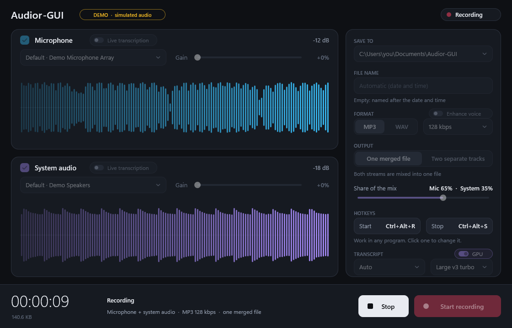

*The window while recording. Every picture in these docs is drawn by the program
itself from simulated audio (hence the DEMO badge, and the sample folder), so none
shows a real PC; `build.bat x64 screenshots` redraws them (see [Design](#design)).*

## Requirements

### To run

| | |
|---|---|
| Windows | Windows 10 or 11, x64 or x86, any edition. A Windows N edition lacks Media Foundation, so MP3 is unavailable there until the Media Feature Pack is installed; WAV works |
| Audio hardware | At least one device: a **microphone** (any capture device) and/or a **playback device**, whose output is recorded as *System audio* (WASAPI loopback). With neither, `--demo` runs the window on simulated audio |
| Windows privacy | Settings → Privacy & security → Microphone must let desktop apps use the microphone. If Windows blocks it, the recorder reports `access was denied (check Windows privacy settings)` or gets no microphone audio |
| Rights | An ordinary user account: no administrator rights, installer, driver or service |
| Display | Direct2D and DirectWrite, which are part of Windows. No GPU is required (Direct2D falls back to software). Segoe UI Variable on Windows 11, Segoe UI on Windows 10 |
| Disk | A writable folder (default `Documents\Audior-GUI`). At 48 kHz, 16-bit, stereo, WAV takes about 660 MiB per hour per file and MP3 about 55 MiB per hour at 128 kbps (137 MiB at 320 kbps); two separate tracks are two files. A full disk ends the recording and keeps what was captured |
| Memory | Fixed: each stream buffers at most 8 seconds, whatever the length of the recording |
| Network | **None** for recording, transcribing and everything else. The one exception is an optional download of a speech model, which happens only after you say yes. No account or API key. See [below](#what-works-offline-and-what-needs-the-internet) |
| Not needed | .NET, the Visual C++ redistributable, WebView2, any third-party library |

### To build

Visual Studio 2022 or its Build Tools with the *Desktop development with C++*
workload (MSVC for x86 and x64, and the Windows SDK), plus the in-box Windows
PowerShell, which runs the import check. `build.bat` finds Visual Studio itself and
downloads nothing: there is no package manager and no third-party code to fetch.

Like audior, the app uses **only WASAPI (for audio) and libraries that ship with
Windows**: Media Foundation for MP3, Win32 with Direct2D, DirectWrite and WIC for
the window. `tests/check_imports.ps1` fails the build if the executable ever
imports a DLL outside an allowlist of in-box Windows DLLs. Media Foundation is
loaded on demand, so the program also starts on a Windows N edition without it
(MP3 recording then says so; WAV works).

## What works offline, and what needs the internet

**Everything is local.** Recording both streams, the gains, the merge, WAV and MP3
encoding, the waveforms, live transcripts and every command-line option work with no
connection, no account and no key. Neither the recorder nor the transcription helper
contains networking code, and `tests\check_imports.ps1` fails the build if either
imports a networking DLL. Unplugging the network changes nothing.

The internet is used for one thing only: **downloading a speech model, once, and only
if you say yes** (see *Live transcripts* below). When the transcription helper is
installed but no model is, the program asks whether to download one; if you decline,
nothing is ever sent and transcription simply is not offered. The download is done by
a separate small program, `audior_fetch.exe`, so that the recorder itself stays free of
networking code. It uses only Windows' own WinHTTP; asks `huggingface.co` over HTTPS
(which sends it on to the CDN that serves the file, whose address changes: a firewall has to allow the
redirect too) and no other address of its own choosing; creates one
new `.part` file and writes nothing else; and what it brings is checked by the recorder
against the size and SHA-256 published for that model before it is used, so a file from
anywhere else would simply be refused. Delete `audior_fetch.exe` and the program cannot download anything.
Your audio never leaves the PC. Transcription runs in a separate helper program, so
neither a model nor a problem in it can touch a recording, and the recorder itself
stays dependency-free. A transcription problem never stops or damages a recording.

**Cloud transcription is a placeholder.** Nothing for it is built. If it is ever added
it will be opt-in, off unless you switch it on, and the pane will show when it is in
use.

## Build and run

```bat
build.bat              :: x64 + x86: the app and the unit tests, then runs the tests
build.bat x64          :: one architecture
build.bat x64 tests    :: just the unit tests (the quick edit-test loop)
build.bat hardware     :: also builds bin\<arch>\hardware_tests.exe (not run: it records)

bin\x64\Audior-GUI.exe
```

`build.bat` also makes `bin\<arch>\audior_fetch.exe` and its list `audior_fetch.sha256`
(the download program, see *At start-up* below); keep them next to `Audior-GUI.exe`.

`build.bat` finds Visual Studio itself (via `vswhere`), so any command prompt
works. The binaries use audior's "hybrid CRT" settings (static VC runtime,
in-box Universal CRT).

No Visual Studio? Every push is built by CI on a Windows machine; download
`audior-gui-windows` from the run's *Artifacts* and unzip it.

**Setting up the compiler** (once, from any prompt; it asks for administrator
approval and downloads a few GB). This installs the Build Tools with the *Desktop
development with C++* workload: MSVC for x86 and x64 and the Windows SDK, which is
everything the project needs. Built and tested this way with Build Tools 17.14,
MSVC 14.44 and Windows SDK 10.0.26100.

```bat
winget install --id Microsoft.VisualStudio.2022.BuildTools --exact --override "--quiet --wait --norestart --add Microsoft.VisualStudio.Workload.VCTools --includeRecommended"
```

## Every audior option, in the window and on the command line

| audior option | In the window | Command line |
|---|---|---|
| `-o, --output <file>` | **Save to** folder + **File name** box. Empty: `Audior-GUI-<date>-<time>`. The extension follows the format (`meeting` becomes `meeting.mp3`, `clip.wav` with MP3 becomes `clip.mp3`). A file is never overwritten: a taken name becomes `meeting (2).mp3`. | `-o, --output <file>`, also starts recording |
| `-f, --format` | **Format** MP3 / WAV | `-f wav\|mp3` |
| `-b, --bitrate` | **Format** bitrate list (96 to 320 kbps) | `-b <kbps>` |
| `-m, --mic` | Microphone pane drop-down: every detected input device | `-m <id\|index\|name>` |
| `-a, --amplify` | Microphone pane **Gain** 0 to 300% | `-a <0-300>` |
| `-i, --include-output` | **System audio** checkbox | `-i` |
| `-d, --output-device` | System audio pane drop-down: every playback device | `-d <id\|index\|name>` |
| `--merge [percent]` | **One merged file** + **Share of the mix** slider (the microphone's share, default 65%) | `--merge [percent]` |
| `--separate` | **Two separate tracks**: `<name>_mic` and `<name>_system` | `--separate` |
| `-l, --list-devices` | The device drop-downs list them all | `-l` |
| `-s, --stop` | **Stop** | `-s` stops the recording in progress (audior's own `--stop` works too: same signal) |
| `-h, --help` | | `-h` |

Beyond audior: a **gain for system audio** (`--system-amplify <0-300>`), the **Enhance voice** switch (`--enhance-voice`), a
checkbox to leave the **microphone** out (system audio alone), `--demo`, `--defaults`
(see [Settings are remembered](#settings-are-remembered)), and live waveforms with a
peak level and a clipping flag for every stream.

**Live transcripts.** Each pane has a **Live transcription** switch (`--transcribe-mic`,
`--transcribe-system`) that shows the stream's speech as text under its waveform
while recording: the text grows about once a second while someone speaks, the
last words can still change, and a phrase is settled and timestamped when the
speaker pauses. It runs entirely on your PC: nothing is sent anywhere.

**Enhance voice.** The **Enhance voice** switch next to **Format** (`--enhance-voice`; it is
**off** until you switch it on, and the choice is remembered) makes a clearer copy of what you
recorded, so that a lecture, a meeting or a call is easier to follow. When you press **Stop**
the recording is saved as always; then, in the background, the program reads it twice (the
first time to listen: how loud the speech is, how loud and what kind the background noise is,
taken from the pauses; the second time to improve it) and writes the result **beside it** as
`<name> - enhanced.mp3` (`.wav` for WAV; with two separate tracks, one copy of each). The
recording itself is never changed, and a copy never replaces a file. What is done to the
voice:

1. rumble and hum below 80 Hz are cut (a 4th-order high-pass);
2. the steady noise (fans, air conditioning, the hiss of a microphone) is taken down by up to 12 dB,
   by a spectral Wiener filter whose picture of the noise comes from the quietest stretches of the
   recording itself; it never cuts to nothing, and it eases off when the "noise" is almost as loud
   as the speech (it would be the speech);
3. a little less boom (-2 dB at 250 Hz) and a little more presence (+2.5 dB at 3 kHz);
4. the speech is brought to a steady loudness (about -17 dBFS while someone speaks): a fixed gain,
   then a gentle 2:1 pull of the loud and the soft parts toward it, which leaves the pauses alone
   so that the noise between sentences is not raised;
5. a look-ahead limiter at -1 dBFS, so that nothing clips.

The bottom bar shows *Enhancing voice… 42%* with a bar under it, and **Cancel enhancing** (where
*Show in folder* is otherwise) gives the copy up: the half-written file is removed, the recording
stays. Starting a new recording, closing the window or signing out ends it too.
Plan on a minute or two of work per hour of audio on a modern PC, on one core at a priority below
normal. Nothing is sent anywhere: it is arithmetic on your own files, with no library but Windows
(an MP3 recording is decoded and encoded again by Media Foundation, so for the best result record
WAV, or use a high bitrate). It is made for **speech**: it does not remove other people talking,
echo or music, and it is no use on a recording with no pauses at all, where the program cannot
tell the noise from the voice.

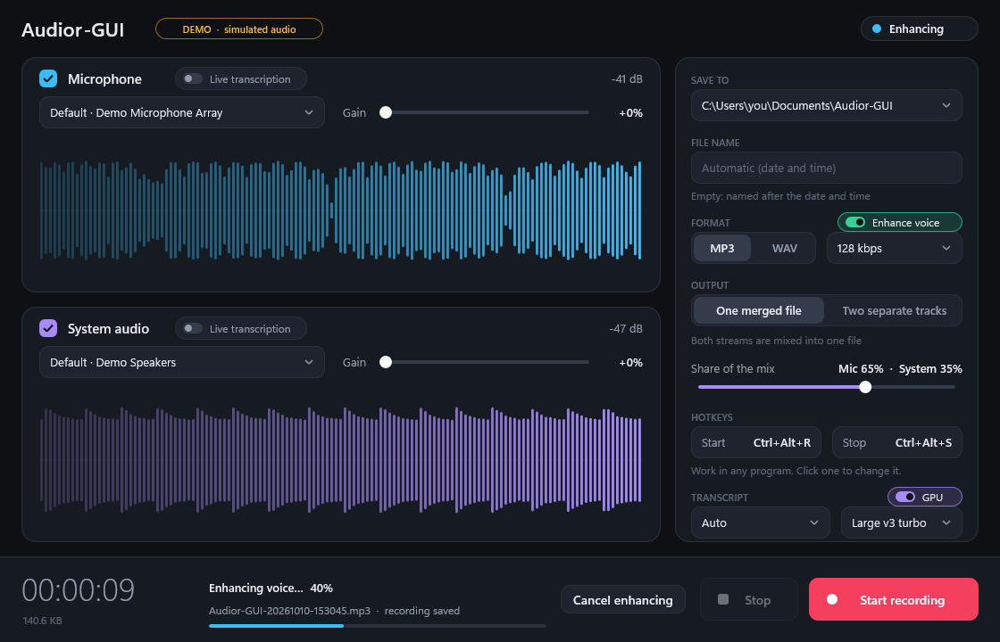

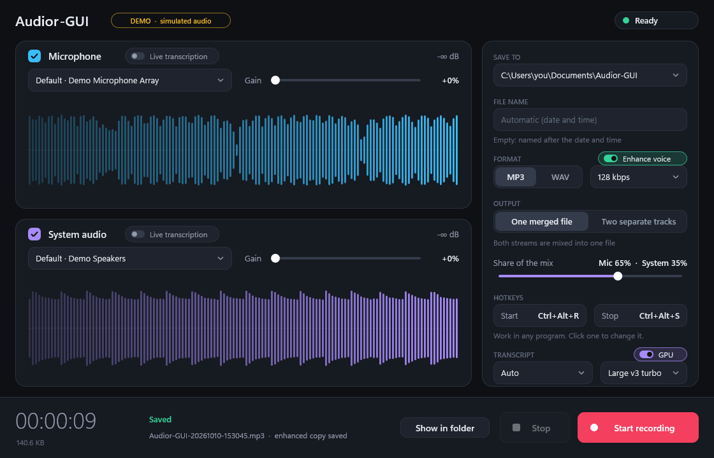

It is optional and needs two things, otherwise the switch stays hidden (`--demo`
has a built-in script and always shows it):

1. **The helper**, `audior_asr.exe` with its DLLs and `audior_asr.sha256` (the
   list of them with their SHA-256), next to `Audior-GUI.exe`. It must come from the
   same build as the program: one of another version refuses to start with *do not
   speak the same version*, so build it again whenever the program is. `build.bat x64 asr`
   builds it (it compiles whisper.cpp, so it needs the *C++ CMake tools for
   Windows* of Visual Studio, and takes a few minutes the first time).
   `build.bat x64 vulkan` builds it with the Vulkan backend (`ggml-vulkan.dll`), so
   that the graphics card can do the work; that needs the
   [Vulkan SDK](https://vulkan.lunarg.com/sdk/home) installed. With that DLL a
   **GPU** switch appears in the Transcript section (`--transcribe-cpu` turns it
   off from the command line). A PC without a usable Vulkan driver simply uses the
   processor, and the first use of the card takes several seconds longer while the
   driver prepares its code.
2. **A speech model**, in `%LOCALAPPDATA%\audior-gui\models` (or the folder named
   by the `AUDIOR_MODELS` environment variable): `ggml-large-v3.bin` (Whisper
   large-v3, about a hundred languages including Chinese, 2.9 GiB, needs a graphics card to keep up
   with speech), its 5-bit version `ggml-large-v3-q5_0.bin` (1.0 GiB, for a card of 4 GiB or more) or `ggml-parakeet-tdt-0.6b-v3-q8_0.bin` (Parakeet, 25 European languages, 638 MiB,
   light on the processor); `ggml-large-v3-turbo-q5_0.bin` (many languages, 547 MiB, slow without a
   GPU) is used too if it is there. Only these files, with these sizes and SHA-256 values (`src/core/asr_models.h`),
   are used. The program downloads one for you if you let it (next section), or you
   download one yourself from <https://huggingface.co/ggerganov/whisper.cpp>.

**Whisper.** `ggml-large-v3.bin` (Whisper large-v3 at full precision, 2.9 GiB) is the top end:
the most accurate, understanding about a hundred languages (the one to use for Chinese,
Japanese, Korean, Arabic and the rest that Parakeet does not know), and offered to a PC
whose graphics card has 8 GiB or more of its own memory. `ggml-large-v3-q5_0.bin` (the same
model in 5 bits, 1.0 GiB, nearly the same words) is offered to a card of 4 GiB up to 8 GiB
instead (no card gets both); a PC with a smaller card or none is offered neither, as the
processor cannot keep up with them. `ggml-large-v3-turbo-q5_0.bin` (the turbo model, quantised and a little weaker in
languages other than English) is still used if it is in the folder, but is not offered
any more. There is no English-only model: every model here also understands other languages.

**Parakeet, an alternative.** `ggml-parakeet-tdt-0.6b-v3-q8_0.bin` (638 MiB, from
<https://huggingface.co/ggml-org/parakeet-GGUF>) is NVIDIA's Parakeet TDT 0.6B v3, a
different kind of model from Whisper and, on the processor, far lighter: a minute of
speech at the pace of speech cost the helper about 0.08 of a core, against 7 cores for
the large Whisper turbo model, with the same words. It recognises 25 European languages
(Bulgarian, Croatian, Czech, Danish, Dutch, English, Estonian, Finnish, French, German,
Greek, Hungarian, Italian, Latvian, Lithuanian, Maltese, Polish, Portuguese, Romanian,
Russian, Slovak, Slovenian, Spanish, Swedish, Ukrainian) and finds the language of what
it hears by itself, so there is no language to choose: the language field says *European
languages* and is greyed out for it, and `--transcribe-language` does not apply. **It does
not know Chinese, Japanese, Korean, Arabic or Hindi** (heard in one of those it writes
something that looks like a European language); choose Whisper for them. Its weights are NVIDIA's,
under CC BY 4.0 (see `THIRD-PARTY-NOTICES.md`).

Optionally, `ggml-silero-v5.1.2.bin` (864 KiB, from
<https://huggingface.co/ggml-org/whisper-vad>) in the same folder. Without it a
phrase begins when the stream gets clearly louder than the room and ends at a
pause; with it the *Silero* voice detector decides where speech is, which copes
better with a fan, music or a keyboard in the background.

With a model in place the settings panel gets a **Transcript** section: the model
(when more than one is installed; the first one found is the default;
`--transcribe-model <file>`) and the language (`--transcribe-language <language>`):
*Auto* lets Whisper recognise the language of each phrase; naming the language tells
it what to expect, which is more exact (a short phrase is sometimes taken for the wrong
language otherwise) and a little faster. The choice is English, Chinese, Traditional Chinese,
Spanish, French, German, Japanese, Korean, Portuguese, Russian, Italian, Dutch, Arabic, Hindi,
Turkish, Vietnamese, Thai, Polish, Ukrainian and Indonesian (on the command line `auto`,
`en`, `zh`, `zh-hant`, `es`, `fr`, `de`, `ja`, `ko`, `pt`, `ru`, `it`, `nl`, `ar`, `hi`, `tr`,
`vi`, `th`, `pl`, `uk`, `id`). *Chinese* also asks for Simplified characters and *Traditional
Chinese* for Traditional ones; with *Auto*, Whisper may write some phrases one way and some the
other. Text in any script is shown as it comes and saved as it is (the transcript files are UTF-8
with a byte-order mark, which Notepad and Excel read right).

### At start-up: the PC is scanned, and a model is offered

With the helper installed, the program looks at the PC every time it starts, and
a notification above the two panes says what it is doing and what it found:

1. **Scanning.** It asks Windows (DXGI) for the graphics cards and checks that the
   graphics driver has installed Vulkan. If there is a card, a Vulkan driver and a
   helper built with `build.bat vulkan`, transcription uses the card (the **GPU**
   switch works as you set it); otherwise recordings do not ask for a card, so that the
   helper does not lose time trying, the switch is off and cannot be turned on, and
   the notification says why. Your saved choice is not changed, so it applies again on
   a PC (or after a driver) where the card can be used. (`--transcribe-cpu` is always
   respected.)
2. **A model is installed:** the notification says *Live transcripts are ready*, names
   the card and the model, and goes away by itself. Nothing is downloaded.
3. **No model is installed:** the notification asks, naming the files, their size and
   where they come from, and nothing is downloaded until you press **Download**.
   Every PC is offered Parakeet (the alternative to Whisper, for European languages and
   light on the processor) and the small voice-activity detector; a PC whose card has 8 GiB
   or more of its own memory, and can use it for transcription (see step 1), is offered
   Whisper large-v3, the most accurate model and the one for Chinese and the other
   languages Parakeet does not know, as well, and one whose card has 4 GiB up to 8 GiB
   the 5-bit large-v3 in its place.

   

4. **Downloading:** the notification shows which file, how much and a progress bar, with
   a **Cancel** button; the recording and everything else keep working. Each file is
   checked (size and SHA-256) before it gets its name, so a damaged or tampered file is
   never used; a failed or cancelled download leaves nothing behind. When it is done the
   **Live transcription** switches and the model choice appear without a restart.

   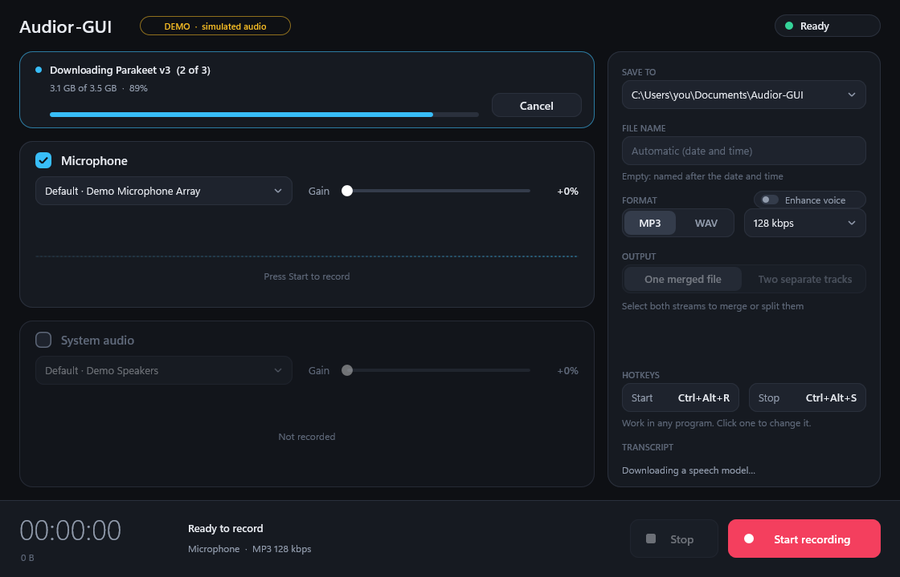

If you press **Not now** the program takes that for an answer and does not ask again
(it is kept with the other [remembered settings](#settings-are-remembered), as the line
`modelDownload=declined` of `Audior-GUI.ini`; change it to `ask` to be asked at every
start); instead the **Transcript** section of the panel says *No speech model is
installed* and has a **Download…** link, which asks again whenever you want.

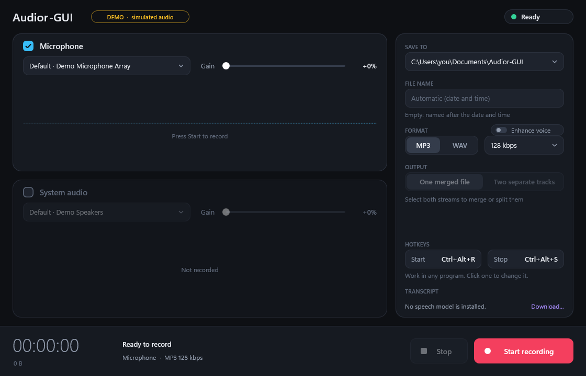

A failed download (no connection, say) says why and offers **Try again**; it is asked
about again at the next start. With the window in the tray, a balloon says when the
question waits for an answer and how a download ended, and the tray tooltip shows its
progress. Without `audior_fetch.exe` next to the program (and its list,
`audior_fetch.sha256`) the program cannot download, says so, and tells you where to put
a model by hand. The start-up check does nothing at all when the helper is not
installed, or with `--demo`.

**If the PC cannot keep up** (a big model, two busy streams, a busy CPU) the pane
says *Catching up* with how far behind the text is. Settled phrases always come
before drafts of the phrase being spoken, so drafts are what gets skipped first. If
a stream stays six seconds or more behind for ten seconds, a smaller installed
model takes over by itself (*smaller model* shows in the pane) and the recording is
not touched (a model of the same kind, Whisper or Parakeet, and one that understands the
same languages: every Whisper model here does). A phrase that was still not decoded in time is shown
as `…` instead of being left out silently.

**Saved transcripts.** Each pane's text is also saved, phrase by phrase as it settles, in a
text file beside the recording: `<recording> - microphone.txt` and
`<recording> - system audio.txt`. A line is a time and a phrase, `[0:06] The weather today is
cold.`, and the file is UTF-8 with a byte-order mark, so any language (and Notepad) reads right.
It is written while recording, not at the end, so it is as long as the recording, however far
behind the window falls, and a recording that ends badly keeps what was said. It holds what the
pane shows: a phrase still being spoken when the recording stops (or when the helper dies or is
changed to a smaller model) is written as it stood. What the helper has not decoded by about three
seconds after Stop is lost, in the pane too. A pane nobody spoke in leaves no file. A recording
and its transcripts take the next free number together (`meeting (2).mp3`,
`meeting (2) - microphone.txt`), so a transcript is never overwritten. After Stop the status says
*1 transcript* or *2 transcripts*. A phrase is at most 511 characters (15 s of fast speech is about
300). If a file cannot be written the status says so and the recording is not affected.

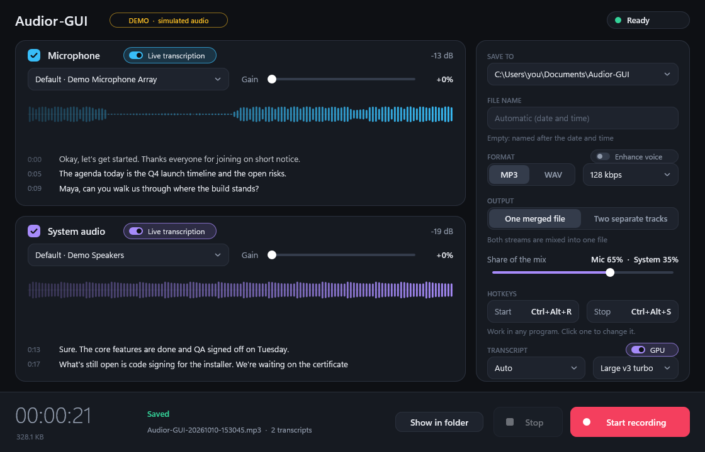

Any script works: Chinese, Japanese, Korean, Arabic, Hindi, Thai and the rest are shown as they
are said, in the panes and in the files (with Chinese, Whisper large-v3 told the language is
*Chinese*; Parakeet does not know it):

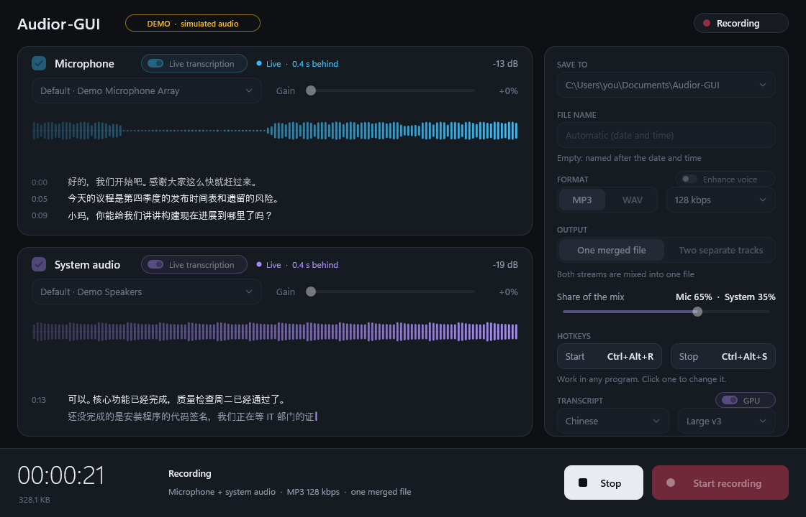


The helper is a separate process, so a problem with it can never end or damage a
recording: it is started at low priority inside a Windows Job object, restarted if
it dies, given up on after a few quick crashes (the pane then says *Transcript
stopped* and why) and killed with the recorder. Its licences are in
`THIRD-PARTY-NOTICES.md`.

The command-line options only preset the window, so a shortcut such as

```bat
Audior-GUI.exe -o "%USERPROFILE%\Music\standup" -f wav -i --separate -a 50
```

opens the window already recording, with everything still adjustable. The options
change the [remembered settings](#settings-are-remembered) of the last run, so a
shortcut that must behave exactly like `audior` adds `--defaults`.
`Audior-GUI --help` lists the options; `Audior-GUI --list-devices` prints the
devices as `audior --list-devices` does. Output goes to the console that started
the program, or to the file or pipe it was redirected to
(`Audior-GUI --list-devices | more`).

## Settings are remembered

The window starts from **the settings of the last run**. They are kept in a small text
file, **`Audior-GUI.ini`, in the same folder as `Audior-GUI.exe`**, so a copy of the
program carries its settings with it. The file holds every setting in the panel and
the two hotkeys. It is read when the program starts and written when a recording
starts, when you change a hotkey and when the program ends (also when Windows shuts
down), so the settings you recorded with are the ones you find next time.

- **The command line changes them.** `Audior-GUI -b 192` starts from the remembered
  settings with the bitrate changed, and the next run remembers that. An option that
  switches something on (`-i`, `--transcribe-mic`, `--transcribe-system`,
  `--transcribe-cpu`) cannot switch it off again, so a shortcut that must not inherit
  those uses `--defaults`.
- **`--defaults`** starts from the built-in defaults instead and neither reads nor
  changes the file: use it in a script or shortcut that must behave exactly like
  `audior`. **`--demo`** reads the file but never writes it.
- **A bad file does no harm.** A missing, damaged or hand-edited file is read line by
  line: a line that is not valid (an unknown key, a number out of range, a folder that
  is not a full path, a model that this program does not know) is skipped and that
  setting keeps its default. Delete the file to start afresh. Two things are checked
  against the PC: a microphone or playback device that is no longer plugged in is
  replaced by the system default, and a folder that cannot be made (the file came from
  another PC, or the drive has gone) by `Documents\Audior-GUI`. A speech model that is no
  longer installed is forgotten (the first one found is used again; a
  `--transcribe-model` that is not installed is reported when you press Start, naming it).
- **The folder must be writable.** In a read-only place (Program Files, a locked
  drive) the program works as before but nothing is remembered; keep it somewhere you
  can write to. The file is replaced in one step, so it is never left half-written. A
  copy of the program that is moved to another PC brings its settings along.
- The hotkeys used to be kept in the registry (`HKEY_CURRENT_USER\Software\Audior-GUI`);
  that is no longer read, so a pair you had set is Ctrl+Alt+R and Ctrl+Alt+S again
  until you change it.

The file is UTF-8 text, one `key=value` per line; lines starting with `#` are notes.
You may edit it while the program is closed (UTF-16 with a byte order mark, as
PowerShell 5's `>` writes it, and ANSI are read too; the program saves it as UTF-8).
The comments here are not in the file:

```ini
folder=C:\Users\you\Documents\Audior-GUI
fileName=                    empty: a name made from the date and time
format=mp3                   mp3 or wav
bitrate=128                  96 112 128 160 192 224 256 320
microphone=on                on or off; at least one of the two streams stays on
microphoneDevice=            a device ID from --list-devices; empty: the system default
microphoneGain=0             0 to 300 (percent)
systemAudio=off
systemDevice=
systemGain=0                 0 to 300 (percent)
mix=merge                    merge or separate
mixMicrophone=65             0 to 100 (percent): the microphone's share of the merged mix
transcribeMicrophone=off
transcribeSystem=off
transcribeModel=             one of the model file names above; empty: the first one found
transcribeLanguage=auto      auto, en, zh, zh-hant, es, fr, de, ja, ko, pt, ru, it, nl, ar, hi, tr, vi, th, pl, uk or id
transcribeGpu=on
enhanceVoice=off             on or off: a clearer copy of the voice after each recording
startHotkey=Ctrl+Alt+R
stopHotkey=Ctrl+Alt+S
modelDownload=ask            ask or declined: declined once you press Not now to the offer to download a model
```

## How a recording behaves

- **Format.** Everything is converted to 48 kHz, 16-bit, stereo, whatever the
  device delivers (8 to 32-bit integer or float, mono to 7.1, any sample rate).
  WAV is uncompressed PCM; MP3 is constant bit rate from the in-box Media
  Foundation encoder.
- **Merge.** Both streams are mixed with weights that add up to 1, so a merged
  file cannot clip at any split. **Separate** writes two files that span the
  whole recording and stay aligned. All streams share one clock, which starts when
  the first device is running; a stream that is not delivering is filled with
  silence up to it, both while nothing is playing (a playback device sends nothing
  when idle) and while a device is still starting (a Bluetooth microphone needs most
  of a second), so the tracks begin together and end together.
- **Enhance voice** (when switched on) starts after the files are finalised, so a recording
  never waits for it and never depends on it: if the copy cannot be made (a full disk, a file
  that is open elsewhere) the window says so, and the recording is as it was. The copy is as
  long as the recording (an MP3 copy to within a few hundredths of a second: the codec pads
  its own audio a little). Names are numbered together: if
  `meeting - enhanced.mp3` already exists, the next recording is `meeting (2).mp3`.
- **Gain** is applied before the 16-bit clamp, and the waveform shows the stream
  after its gain, so clipping is visible. Merging weights come afterwards.
- **Memory stays bounded.** Audio is written to disk as it is recorded; each
  stream may buffer at most 8 seconds, and a disk that cannot keep up ends the
  recording instead of growing memory.
- **Failures keep your audio.** If a device vanishes, a disk fills up, or a file
  cannot be finalised, the recording stops at once, what was captured is
  finalised into a valid file, and the window says what happened (for example
  `Audio capture failed: the device was unplugged or switched off (hr=0x88890004)`).
  WAV is limited to 4 GiB, about 6 h 12 min.

  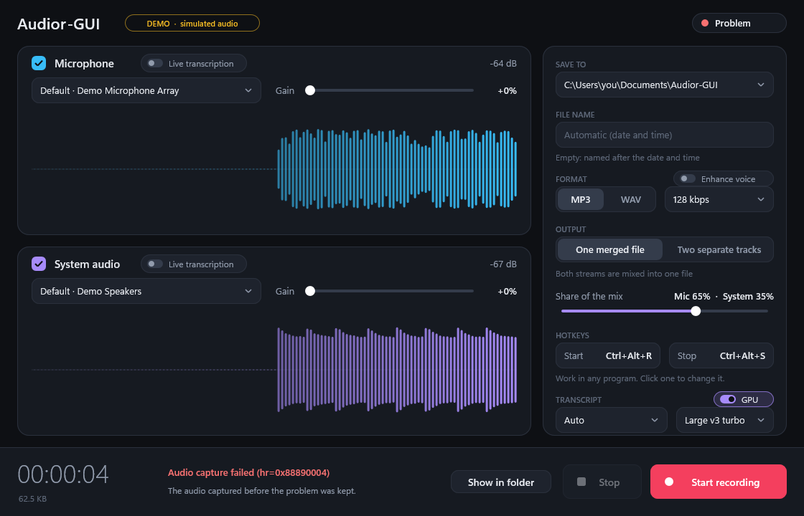

- **Other programs keep their volume.** The recorder opts out of Windows'
  "communications activity" ducking.
- **Bluetooth headsets switch to call mode.** Opening a headset's microphone makes
  Windows switch it from stereo music mode to its hands-free (phone call) mode, and
  back when the recording ends: while recording, the headset's output drops out for
  about half a second, its volume steps (40 to 45 on the one tested) and the sound is
  thinner. That is the headset and Windows, not this program, and it cannot be avoided
  while the microphone is open, so the microphone pane says so when the chosen
  microphone is Bluetooth, with a **Record system audio only** link that unticks the
  microphone and ticks system audio in one click (**Live transcription** switched on for the
  microphone is switched on for the system audio too). System audio only does not trigger
  the switch, nor does a microphone that is not Bluetooth. Measurements in
  [docs/HARDWARE-TESTS.md](docs/HARDWARE-TESTS.md), finding 6.

  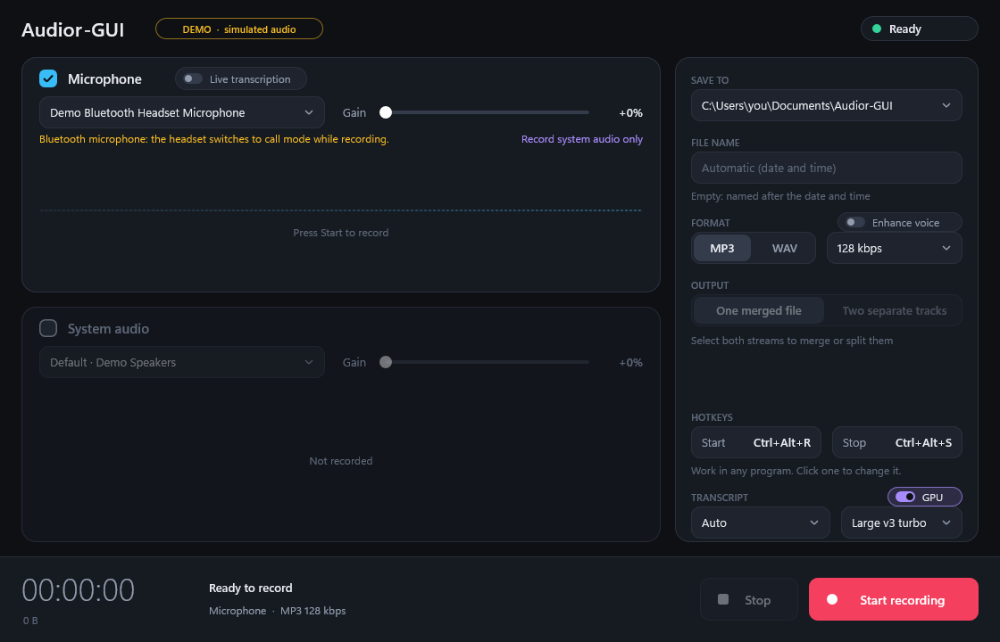
- **Closing the window, `--stop`, or Stop** all finalise the files and release
  the devices (a Bluetooth headset returns to normal playback).
- **Stopping from outside.** While recording, the program holds the named event
  `Local\AudiorStopEvent`, the same one audior uses, so `Audior-GUI --stop` and
  `audior --stop` each end a recording started by either.

## Tray and hotkeys

- **Minimizing goes to the tray.** The window leaves the taskbar and the Audior-GUI
  icon appears in the notification area: a ring while idle, a red dot while
  recording, with the elapsed time in its tooltip. Click the icon to bring the
  window back; right-click it for *Show*, *Start recording*, *Stop* and *Exit*. A
  recording carries on while the window is in the tray, and a balloon says so if
  one ends with a problem there. A program started minimized (a shortcut set to
  *Run: Minimized*) goes straight to the tray. Closing the window with the X still
  stops the recording and exits.
- **System-wide hotkeys.** **Ctrl+Alt+R** starts a recording and **Ctrl+Alt+S** stops it,
  in whatever program has the focus, with the window open or in the tray. They do
  what the buttons do, so Start is ignored while recording and Stop while idle.
- **Yours to change.** In the *Hotkeys* section of the settings panel click a box
  and press the new shortcut (Esc cancels, and a shortcut that cannot be used says
  why and keeps listening). A shortcut is a letter, digit, function key (F1 to
  F24), Space or a navigation key, with Ctrl and/or Alt (and Shift if you like);
  a function key may stand alone. Start and Stop must differ, and a shortcut that
  another program already owns is refused. The pair is remembered for the next run
  (in `Audior-GUI.ini`, see [Settings are remembered](#settings-are-remembered)); if a remembered shortcut cannot be
  taken at start-up, for instance because a second copy of the program is running,
  its box is outlined in red and it stays off.
- **A global shortcut is taken from every other program** while Audior-GUI runs.
  The defaults avoid Ctrl+R and Ctrl+S, which other programs use for *reload* and
  *save*. On a keyboard layout where AltGr (which Windows treats as Ctrl+Alt) types
  letters, though, Ctrl+Alt+S or Ctrl+Alt+R may be a character you need (the Polish
  layout types ś with AltGr+S); choose another pair, such as two function keys.

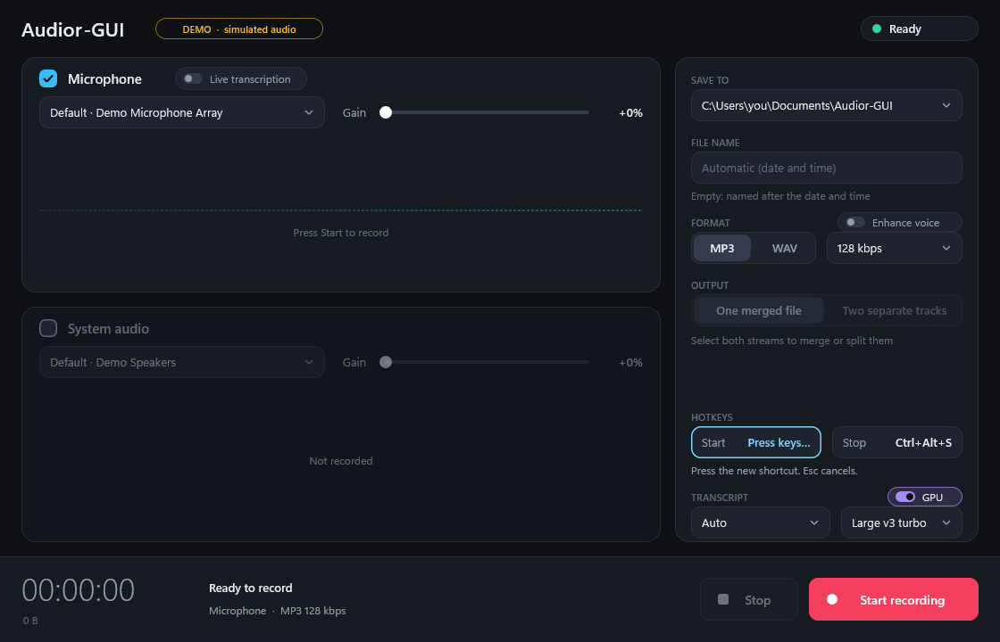

## Design

- **One pane per stream**, each with its own **checkbox** (is this stream
  recorded?), a **drop-down of every detected device** (refreshed whenever it
  opens, so a newly plugged-in microphone appears), a **gain** slider, a peak
  level in dB, a **CLIP** flag and its waveform. At least one stream must stay
  ticked.

  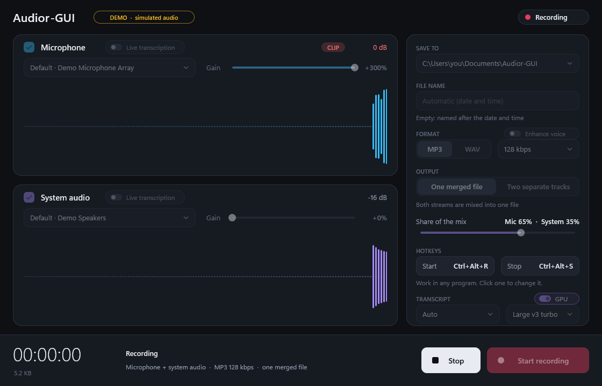
- **Scrolling bars.** Bar heights follow a dB scale (about 54 dB of range),
  newest on the right. The playhead glides at the real-time rate even though audio
  arrives in bursts.
- **Scrolling text.** With a transcript on, the waveform shrinks to a strip and
  the newest lines fill the pane, older ones fading upwards. Only the last twelve
  lines are kept, so memory stays flat however long you record; a transcript
  problem is shown in its pane and never ends the recording.
- **Settings lock while recording**, as audior's options do. Everything works from
  the keyboard: Tab moves between controls, Space / Enter activate, arrow keys
  adjust sliders and segmented controls, the file name box edits like any text
  box (Ctrl+A / C / X / V, Home / End, Ctrl+arrows).
- **Sharp everywhere.** Everything is laid out in DIPs; the window is
  per-monitor DPI aware.
- **Idle means idle.** The frame timer runs only while a recording or a waveform
  is moving, and a window hidden in the tray draws nothing and ticks only five
  times a second.

Colours, sizes and the type scale live in `src/ui/theme.h` and `src/ui/gfx.cpp`.
To see the UI without opening it, render a scenario to a PNG:

```bat
bin\x64\Audior-GUI.exe --screenshot ui.png --scenario recording --size 1120x720
```

Scenarios: `idle`, `recording`, `mic-only`, `system-only`, `bluetooth-mic` (a
headset microphone chosen), `clipping`, `saved`, `error`, `transcript`, `transcript-saved`, `transcript-chinese` (the same in Chinese), `catching-up` (the transcription has fallen behind), `model` (a
Whisper model chosen), `named`, `typing`,
`hotkeys` (a shortcut box waiting for keys), `hotkey-taken` (a shortcut another
program owns), and the start-up notification of transcription: `setup-scan`,
`setup-ask`, `setup-download`, `setup-done`, `setup-failed`, `setup-declined`.

The pictures in this README and in `docs/` are such scenarios, kept in
`docs/screenshots/` (named after their scenario, drawn at 1120x720 from simulated
audio, so they hold nothing from a real PC). **When the window changes, redraw
them and commit the new pictures with the change:**

```bat
build.bat x64 screenshots      :: builds, then renders every picture the docs use
```

If a change adds a picture to the docs, add its scenario to the `:shots` list in
`build.bat` as well.

## Architecture

```
  Win32 window -> MainView (layout, paint, input) -> RecorderController -> IRecordingEngine
  src/ui          src/ui                             src/core             src/engine
```

| Path | |
|------|--|
| `src/core` | No Windows or UI headers. Settings and their rules (mirroring audior's options and limits), the text of the settings file (`saved_settings`), the command line, the hotkey rules and their text form, the text-box editing model, formatting, `PeakHistory`, `PeakMeter`, `WaveformLane` (smooth scrolling model), `TranscriptLane` (the last lines of a live transcript), `RecorderController` (the state machine), the `IRecordingEngine` interface, and the rules of the start-up set-up of transcription: `setup_plan` (what a scan of the hardware decides: the graphics card, which models to offer), `setup_status` (the notification's words) and `fetch_protocol` (what the download program says); and the voice enhancement, all plain arithmetic on 48 kHz stereo floats: `fft`, `voice_dsp` (filters, the spectrum, the denoiser, the leveler, the limiter) and `voice_enhancer` (the analysis pass and the processing chain). |
| `src/engine` | `WasapiEngine` and `SimulatedEngine` behind that interface. See below. For transcription: `SpeechDecimator`, `TranscriptionHost`, `ProcessTransport` and `asr_helper`; and for its start-up set-up `hardware_scan` (DXGI), `TranscriptionSetup` (the conversation: scan, ask, download, finish), `ModelInstaller` (runs the download program, checks what it brings, moves it into place) and `system_setup` (wires them to this PC). For the voice enhancement: `pcm_reader` (WAV) and `mp3_reader` (Media Foundation) read a finished recording back, and `VoiceEnhanceJob` makes the copies on a thread of its own. |
| `src/fetch` | The download program `audior_fetch.exe`: one HTTPS download from `huggingface.co` with WinHTTP into a new `.part` file. The only code of the project that uses the network (see *What works offline*). |
| `src/asr`, `third_party` | The optional transcription helper `audior_asr.exe` (built by `build.bat asr`) and the trimmed whisper.cpp it is linked with. Nothing else in the program uses either. |
| `src/ui` | `AppWindow` (Win32, DPI, frame timer, tray, hotkeys, dialogs, clipboard), `MainView`, `LaneView`, widgets, `TrayIcon` (and the icon, drawn in code), `Painter` (Direct2D), `Gfx` (factories and fonts), `screenshot`. |
| `src/main.cpp`, `src/console.*`, `src/preferences.*` | Entry point; console output for `--help`, `--list-devices`, `--stop`; the settings file `Audior-GUI.ini` beside the exe (read at start-up, written when a recording starts and when the program ends). |
| `tests` | Unit tests for everything outside `src/ui`, a tiny dependency-free harness, the import check, and `ui_smoke.ps1`. `tests/hardware`: the native hardware tests (`hardware_tests.exe`), which record on real devices. |

### The recording engine

```
 WasapiCapture (one thread per stream)           writer thread
   WASAPI shared mode, mic or loopback             every 100 ms
   -> PcmConverter (48 kHz / 16-bit / stereo,      rings -> MixWeighted (merge)
      gain, downmix, resample)                        -> WavSink / Mp3Sink
   -> peak bins to the waveform (100 per second)
   -> 8 s RingBuffer
```

`RecordingSession` owns the threads and takes its capture sources and file sinks
from factories, so every path after the capture (conversion, ring buffers, the
merge, failure handling, the start handshake) is tested with generated audio and
in-memory files. The GUI sees audio only as peak bins through
`IRecordingEngine::TakePeaks()`.

## Testing

- **Unit tests** (`run_tests.exe`, run by `build.bat`): settings and file-name
  rules, the command line, the hotkey rules (which combinations are allowed, their
  text form), the settings file (every setting round-trips; damaged, hand-edited and
  oversized files; a folder that cannot be written to), the text-box model, formatting, peak history and
  meter, waveform alignment, the controller state machine, the simulated engine,
  sample-format conversion and resampling, ring buffers, the mixer, the WAV and
  MP3 sinks, the recording session (merge, separate, device and disk failures,
  overflow, outside stop) and the engine's no-hardware paths; the start-up set-up of
  transcription: what a scan decides (card, driver, which models to offer), the
  notification's words, the whole conversation with the user (ask, download, cancel,
  decline and remember, retry, failure) with made-up hardware and downloads, the
  installer against a stand-in download program (a wrong size or hash, a program that
  dies, cancelling, no partial files left), and the real `audior_fetch.exe`'s refusals
  (any address but https on huggingface.co, any file but a new `.part`, any size a model
  cannot have), none of which needs a connection;
  and the voice enhancement: the FFT against the definition, the filters' gains, the short-time
  spectrum's exact reconstruction, the denoiser (no noise to remove changes nothing; steady noise
  falls, a tone stays), the leveler, a limiter that never passes its ceiling, the whole chain on
  made-up speech with noise of known levels (the speech lands at the target level, the pauses fall
  away, the length is kept whatever the size of the pieces), and the job that writes the copies
  (read twice, written once, cancelled or failed copies removed, a corrupt WAV never crashes it).
- **Import check** (`tests\check_imports.ps1`): only in-box Windows DLLs, and `winhttp`
  only for `audior_fetch.exe`.
- **UI smoke test** (`tests\ui_smoke.ps1`): launches the real executable, drives
  the command line, clicks Start and Stop in the simulated and the real engine,
  checks the status light, that a run leaves its settings in `Audior-GUI.ini` (a
  `--demo` run does not), and saves screenshots. It runs a copy of the exe in a scratch
  folder, so it neither uses nor changes your own saved settings.
- **Hardware tests** (`hardware_tests.exe`, built by `build.bat hardware`, run by hand on a
  PC with a microphone and a playback device): about 100 checks over 14 scenarios, with
  recordings of at least 30 s each, on the real devices. Native C++ like the rest of the
  project; see [docs/HARDWARE-TESTS.md](docs/HARDWARE-TESTS.md).
- **CI** (`.github/workflows/ci.yml`): all of the above, warnings as errors, on a
  Windows runner for every push; screenshots and the executables are published
  as artifacts.

## Known limitations

- Recording from a Bluetooth headset's microphone switches the headset to call mode for
  the duration (see *How a recording behaves*).
- A microphone whose clock runs faster than the PC's is not trimmed, so a very long
  recording could show a small difference between separate tracks.
- Every `Audior-GUI.exe` ends on one machine-wide stop event, so a second recording
  program instance, or `--stop` from another one, stops them all.
- The hardware tests have run on one PC (a Bluetooth headset and two digital outputs);
  other devices, sample rates and wired microphones are untested.
- Drop-down lists use the system pop-up menu, which stays light on the dark UI.
- The UI is custom-drawn, so it does not yet expose UI Automation (screen readers).
- The settings are remembered in a file beside the exe, so nothing is remembered where
  that folder cannot be written to (see [Settings are remembered](#settings-are-remembered)).
- The tray and the hotkeys are exercised by hand (see
  [docs/FIRST-TEST.md](docs/FIRST-TEST.md)); `ui_smoke.ps1` does not cover them.
- Shared mode only: a device another program holds exclusively cannot be recorded.
- **Enhance voice** was tuned on made-up speech with noise of a known level (the unit tests check
  the numbers), not by ear on real lectures: listening to a few of yours is the first thing to do
  (see [docs/FIRST-TEST.md](docs/FIRST-TEST.md)). It is a statistical noise filter, not a model of
  speech, so it cannot tell a steady voice-like hum from a voice, and a recording with no pauses
  gives it nothing to learn the noise from; the same goes for a
  recording whose pauses are digital silence (a muted microphone, a noise gate): the program
  cannot see the noise there, so it takes none out.
