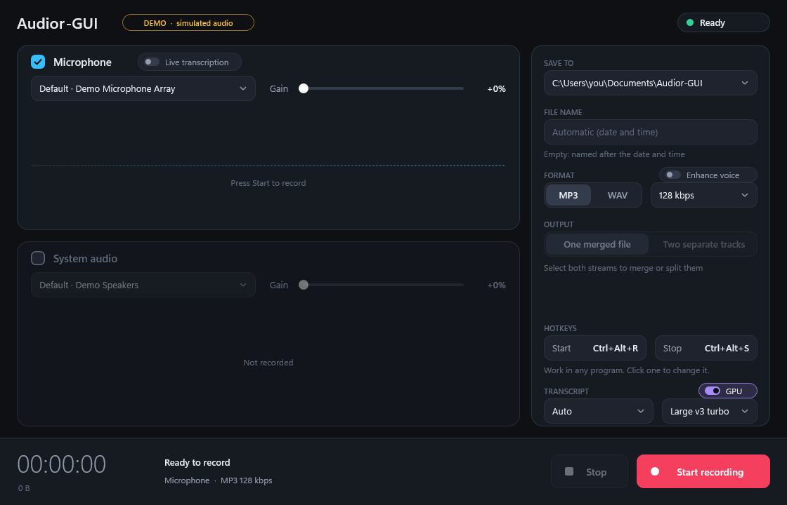
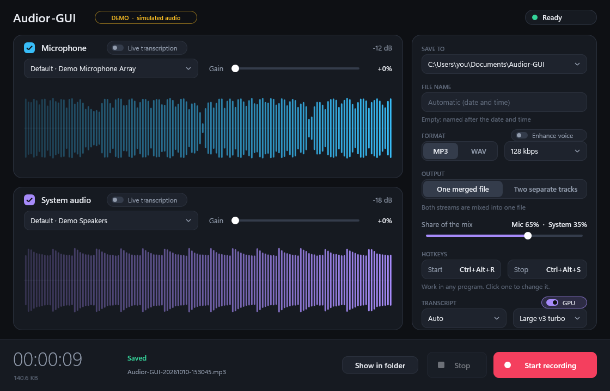

# First test on real hardware

The unit tests cover everything after the capture and the failure paths of the
capture, but the build machines have no microphone. The checks below are the part
only a PC with audio hardware can do.

## Run the automated hardware tests first

`hardware_tests.exe` does most of this list for you, on your devices, and checks the
files it records (length, format, bit rate, levels, track alignment, gain, device
selection, memory and CPU). Build and run it; it takes about 12 minutes and every
recording lasts at least 30 s:

```bat
build.bat x64 hardware
bin\x64\hardware_tests.exe
```

It plays a quiet test tone on the default playback device, records the microphone,
and keeps the application windows behind your other windows without taking the
focus. See [HARDWARE-TESTS.md](HARDWARE-TESTS.md) for what each test checks, the
results on the reference PC and the findings. Covered there: MP3 and WAV from the
microphone (section 1, steps 3 and 4, and the WAV row), merged and separate
recordings with silence kept in step, both gains, naming and collisions, device
choice by id, name and index, closing the window while recording, the other
architecture, the command-line modes (`--list-devices`, `--stop`, bad options).

Still manual, because they need a person or a look at the screen: section 1 steps 1
and 2 (the lists and the resting waveforms), watching the waveforms move, the CLIP
flag with a loud voice, unplugging the USB microphone while recording, unticking
**Microphone**, and the check that other programs' volume does not drop.

The rest of this page is the manual version of everything.

## Get the program

Either build it (`build.bat x64`), or download **audior-gui-windows** from the
*Artifacts* of the latest green run of the CI workflow and unzip it. Run
`Audior-GUI.exe`; there is nothing to install.

If Windows SmartScreen warns about an unknown publisher (the file is not code
signed), choose *More info*, then *Run anyway*.

Each run leaves its settings in `Audior-GUI.ini` for the next (section 5), so a row that
says "type a file name" or "switch the format" is still in force in the rows after it.
Start a section from the defaults when it matters: delete the file, or start the program
with `--defaults` (which neither reads nor writes it).

## 1. The window

1. Start `Audior-GUI.exe`. Both drop-downs should list your devices, each marked
   *Default · name* at the top.
2. While idle the waveforms rest; they move only while recording.

   

   (The pictures here show simulated devices; yours lists your own.)
3. Press **Start recording**, speak, play some music, press **Stop**.
   The waveforms move, the time runs, the status says *Saved*, **Show in folder**
   opens `Documents\Audior-GUI`.

   
4. Play the file. For MP3, check the length matches the clock.

## 2. The cases worth trying

| Try | Expect |
|---|---|
| Tick **System audio**, play a video, record merged | One file with both. Move the *Share of the mix* slider and record again: the balance changes. |
| Same, **Two separate tracks** | `..._mic` and `..._system` files, equal length. Pause the music for a while: the system file still has the full length (silence) and stays in step. |
| Microphone gain 300%, speak loudly | The **CLIP** flag lights; the file is louder. |
| System audio gain 150% | The system waveform is taller and the file louder. |
| Untick **Microphone**, keep **System audio** | Only the system file/lane. |
| Record with a Bluetooth headset's microphone while music plays | A note under the microphone drop-down says the headset switches to call mode. While recording the headset's output drops out for about half a second and its volume and sound change; both return when you stop. With only **System audio** ticked nothing changes. Click **Record system audio only** in the note: Microphone unticks, System audio ticks and the note goes. |
| Type a **File name** (`standup`) | `standup.mp3`; record again: `standup (2).mp3`. |
| Switch **Format** to WAV | A `.wav` file, 48 kHz 16-bit stereo. |
| Unplug the USB microphone *while recording* | Recording stops at once with *Audio capture failed: the device was unplugged...*; the file keeps what was recorded. |
| Close the window while recording | The file is complete and plays. |

## 3. The tray and the hotkeys

These are done by hand: the build machines have no desktop shell to check them on.

| Try | Expect |
|---|---|
| Minimize the window | It leaves the taskbar and an Audior-GUI icon (a ring) appears in the notification area, possibly under the `^` overflow arrow. |
| Click the icon | The window comes back and the icon goes. |
| Press **Ctrl+Alt+R** with the window in the tray, then look at the icon | A red dot, and the tooltip shows `Audior-GUI · recording 00:00:05` counting up. |
| Press **Ctrl+Alt+S** | The icon returns to a ring. Restore the window: *Saved*, and the file is complete. |
| Right-click the icon | *Show Audior-GUI*, *Start recording*, *Stop*, *Exit*, with the hotkeys shown. Only the one that applies is enabled. *Exit* while recording leaves a complete file. |
| Press **Ctrl+Alt+R** in another program (Notepad, a browser) | It starts a recording there too, and Ctrl+S and Ctrl+R still work in that program. |
| Unplug the microphone while recording with the window in the tray | A balloon names the problem. |
| In *Hotkeys*, click **Start**, press **Ctrl+Alt+M** | The box shows `Ctrl+Alt+M`; Ctrl+Alt+R no longer starts a recording and Ctrl+Alt+M does. Close and reopen the program: it is still `Ctrl+Alt+M`. |
| Click **Start**, press **R** alone | Refused: *Add Ctrl or Alt*. The box keeps listening; **Esc** gives up. |
| Choose the other box's shortcut | Refused: *... is already the Stop shortcut*. |
| Run a second copy | Its hotkey boxes are outlined in red: the first copy owns the shortcuts. |
| Start with a shortcut set to *Run: Minimized* | The window never shows; the icon is in the tray. |

The saved shortcuts are the `startHotkey` and `stopHotkey` lines of `Audior-GUI.ini`
beside the exe (section 5); delete the file to go back to Ctrl+Alt+R and Ctrl+Alt+S.

## 4. From a command prompt

```bat
Audior-GUI --list-devices
Audior-GUI -o "%TEMP%\cli-test" -f wav -i --separate     :: the window opens already recording
Audior-GUI --stop                                         :: from another prompt: ends it
```

`Audior-GUI --stop` prints `Stop signal sent.`; with nothing recording it prints
`No active recording to stop.` and exits with code 1. While other programs play
audio, their volume should not drop when you start recording (the communications
ducking opt-out).

## 4. Live transcripts (only with the helper and a model)

Skip this if you have not built the helper. Otherwise: `build.bat x64 asr` (or
`vulkan`, for the graphics card too), keep `audior_asr.exe`, its DLLs and
`audior_asr.sha256` next to `audior_gui.exe`, and put
`ggml-small.en-q5_1.bin` (181 MiB, from the whisper.cpp page on Hugging Face, see
the README) in `%LOCALAPPDATA%\audior-gui\models`. Start the program: each pane
now has a **Transcript** switch. Without the helper or the model it is hidden.

| Try | Expect |
|---|---|
| Switch the microphone's transcript on, record, speak a few sentences with pauses | Text appears under the waveform within a second or two and grows while you speak; when you pause the line settles (capital letters, commas, a full stop) and gets a time. The status says *Live* with a lag of about a second or less. |
| Both streams on, play a video with speech while you speak | Each pane shows its own stream's words. The computer stays usable; recording and the waveforms do not stutter. |
| A long stretch of talking (a minute or more) | Old lines scroll away upwards; the program's memory does not keep growing (Task Manager). |
| Switch the transcript off before recording | `audior_asr.exe` does not appear in Task Manager at all. |
| End `audior_asr.exe` in Task Manager while recording | The pane says *Starting…* and then *Live* again; the recording is not affected. Do it four times quickly (it is restarted after each of the first three): the pane says *Transcript stopped*, and the recording carries on and is saved. |
| Change one byte of `audior_asr.exe` (or delete the model) and start a recording | The pane says the engine's file is not the one in its file list (or the switch disappears); the recording works as always. |
| Close the window, or press Stop, while someone is mid-sentence | The last words still appear (up to three seconds' wait); afterwards no `audior_asr.exe` is left running. |
| Built with `vulkan`: a **GPU** switch is in the Transcript section. Record with it on, then off | On: `audior_asr.exe` shows GPU use in Task Manager, text arrives as usual (the first recording on a PC takes several seconds to start). Off: no GPU use, the processor is busier. Move `ggml-vulkan.dll` away (and fix `audior_asr.sha256`): the switch disappears and the processor does the work. |
| Put `ggml-silero-v5.1.2.bin` in the models folder, play music with no speech and a running fan near the microphone | No text appears for them (compare without the file: the loudness rule may start phrases for the music). Speech over quiet music is still recognised. Damage the file (change one byte): the pane says the model is damaged, and removing the file brings transcripts back. |
| With `ggml-large-v3-turbo-q5_0.bin` in the models folder too, pick it in the **Transcript** section of the settings panel, leave the language on *Auto*, record someone speaking another language | The text comes out in that language. With *English* chosen it is forced into English words. With only the English-only model, the language buttons are greyed and show *English*. |
| With the turbo model chosen and *English* as the language, start a heavy job on all cores (a video encode, say) and talk for a minute | The pane turns amber, *Catching up · N s behind*, and text arrives after each pause rather than while you speak. If it stays six seconds behind for ten, it says *smaller model* and the small English model takes over; when the load ends the pane says *Live* again. With *Auto* it never switches (the small model is English only). The recording is unaffected throughout. |
| Start with `--transcribe-model ggml-large-v3-turbo-q5_0.bin` while that file is not in the models folder | Recording does not start and the message names the missing model. |
| Run the helper alone: `audior_asr.exe --file speech.wav --model <model> [--vad <silero model>] [--english] --realtime` | Lines of `partial` and `final` text, as the recorder would receive them (the WAV must be 16 kHz, mono, 16-bit). |

## 5. Remembered settings

The settings of the last run live in `Audior-GUI.ini`, in the folder of `Audior-GUI.exe`.
The unit tests cover reading and writing it; these are the parts that need the real window
and Windows itself.

| Try | Expect |
|---|---|
| Change the folder, the file name, the format and bitrate, both gains, tick **System audio**, pick other devices, switch on a transcript; close the window; start the program again | Every setting is as you left it. `Audior-GUI.ini` is next to the exe and reads as plain text. |
| Change the bitrate, press **Start** and **Stop**, then change the file name; end `Audior-GUI.exe` in Task Manager (not the X) and start it again | The bitrate you recorded with is back, the file name you typed after pressing Stop is not: the file is written when a recording starts and when the program closes. |
| Start the program, change a setting, sign out of Windows (or restart) with the window open or in the tray | After signing in the setting is kept. |
| `Audior-GUI -b 192` | The window shows 192 kbps and everything else as remembered. Close it and start without options: 192 is now what is remembered. |
| `Audior-GUI --defaults`, change things, close; then start without options | The first window shows audior's defaults (MP3 128 kbps, microphone only, `Documents\Audior-GUI`); the second shows what was remembered before, unchanged. |
| `Audior-GUI --demo`, change things, close; start normally | Unchanged: a demo does not write the file. |
| Choose a USB microphone, close, unplug it, start the program | The microphone box says *Default* and the system default microphone; Start works. Plug the USB one back in and choose it again from the drop-down. |
| Copy `Audior-GUI.exe` and `Audior-GUI.ini` to a PC (or user account) that has no such folder as the saved one | The folder shows `Documents\Audior-GUI` of that user and a recording goes there; the rest of the settings came along. |
| Keep a transcript model chosen in the *Transcript* section, close, move the model file out of the models folder, start and press Start | The message names the missing model; choosing another one in the *Transcript* section lets the recording start. |
| Copy `Audior-GUI.exe` to a folder you cannot write to (a locked drive, or a folder you have set to read-only for yourself), change settings, close, start again | No error anywhere and recording works; the settings are the defaults again. |
| Open the file in Notepad, set `format=wav`, `bitrate=100`, `folder=Recordings` and add a line `colour=blue`; save; start the program | WAV is selected, the bitrate is still 128 and the folder is still the one before: the lines that are not valid are skipped, the rest is used. |
| Delete the file | The next start shows the defaults and the file is back after the next recording. |

## If something is wrong

Note the message in the window, including the `hr=0x...` code, and the output of
`Audior-GUI --list-devices`.
